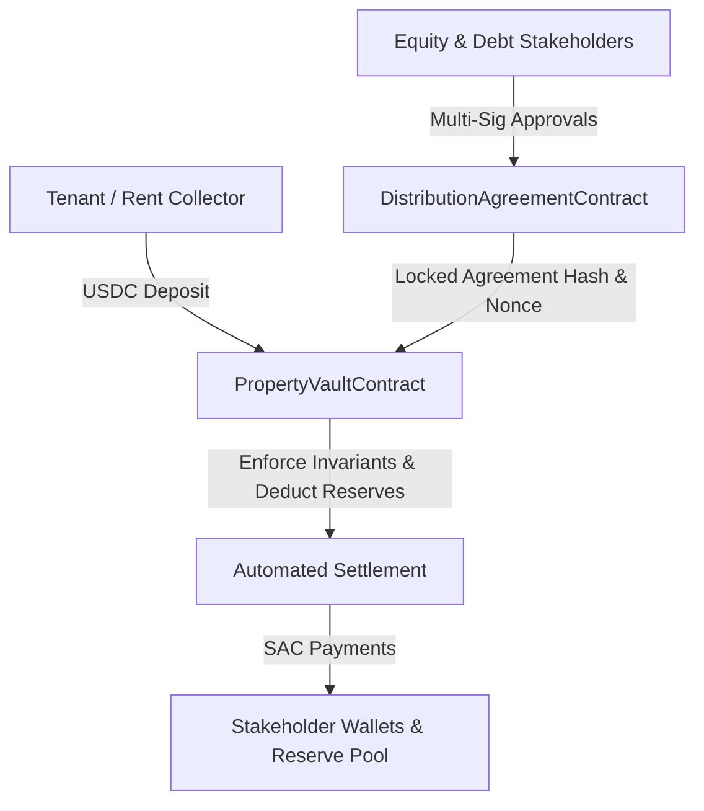

# Stellar Estate — Soroban Smart Contract Technical Specification

**Version:** 1.0.0  
**Target Environment:** Stellar Protocol 22 / Soroban SDK v22.1.3  
**Status:** Submittable / Production-Ready  

---

## 1. Executive Summary & Architecture Overview

Stellar Estate leverages high-performance, deterministic Soroban smart contracts built in Rust to enforce mathematical and cryptographic guarantees on real estate revenue collections, multi-stakeholder consensus, and automated waterfall distributions.

The contract suite consists of two core smart contracts operating in tandem:
1. **`PropertyVaultContract` (`stellar-estate-property-vault`)**: Manages the treasury balances, revenue accounting invariants, reserve retention buffers, and settlement nonces for each tokenized real estate property.
2. **`DistributionAgreementContract` (`stellar-estate-distribution-agreement`)**: Governs agreement versioning, deterministic canonical JSON hashing, and multi-signature stakeholder approvals required before a distribution rule set can be locked and executed.

---

## 2. Soroban Storage Layout & State Modeling

Both contracts utilize Soroban's storage model, partitioning state into **Instance Storage** (contract metadata, global flags, version tuples) and **Persistent Storage** (settlements, agreement versions, stakeholder nonces) to balance execution gas with data longevity.

### 2.1 PropertyVault Storage Keys (`DataKey`)
- `Admin`: `Address` — Authorized administrative address for governance upgrades and emergency pauses.
- `AcceptedAsset`: `Address` — Soroban SAC (Stellar Asset Contract) address for the accepted denomination (USDC).
- `VaultStatus`: `VaultStatus` enum (`Active`, `Paused`, `Settling`, `Liquidating`).
- `Financials`: `VaultFinancials` struct tracking:
  - `total_revenue_pool`: `i128` (Gross accumulated deposits)
  - `distributable_balance`: `i128` (Current net available for distribution)
  - `reserve_balance`: `i128` (CapEx/OpEx reserve retention buffer)
  - `total_distributed`: `i128` (Cumulative lifetime payouts disbursed)
- `SettlementRecord(u64)`: `SettlementExecution` record keyed by the settlement nonce.
- `SettledNonces(u64)`: `bool` tracking whether a settlement nonce has been finalized.

### 2.2 DistributionAgreement Storage Keys (`DataKey`)
- `Admin`: `Address` — Contract governance administrator.
- `AgreementVersion(String, u32)`: `DistributionAgreementVersion` struct keyed by property identifier and version number.
- `AgreementApprovals(String, u32)`: `Map<Address, bool>` storing multi-sig stakeholder approvals.
- `LockedVersion(String)`: `u32` identifying the currently locked, authoritative version number.

---

## 3. PropertyVaultContract Interface Specification

### `initialize(env: Env, admin: Address, accepted_asset: Address, property_id: String) -> ()`
Initializes a new property vault. Requires admin authentication.
- **Preconditions**: Contract must not have been previously initialized.
- **Emits**: Initialized event containing property ID and accepted asset contract.

### `record_revenue(env: Env, from: Address, amount: i128, source: String, nonce: u64) -> ()`
Records an incoming rent or operational deposit.
- **Preconditions**:
  - Vault status must be `Active`.
  - `amount > 0`.
  - `from.require_auth()` is verified.
- **Accounting Mutation**:
  - `total_revenue_pool += amount`
  - `distributable_balance += amount`

### `record_batch_revenue(env: Env, deposits: Vec<RevenueDeposit>) -> BatchRevenueResult`
Processes an atomic batch of revenue collections across multiple property units.
- **Preconditions**:
  - Vault status must be `Active`.
  - Batch size must not exceed 50 entries to satisfy Soroban transaction size limits.
  - Total batch amount matches sum of individual deposits.

### `execute_settlement(env: Env, caller: Address, nonce: u64, agreement_hash: BytesN<32>, gross_amount: i128, reserve_retention: i128, payouts: Vec<StakeholderPayout>) -> SettlementResult`
Executes an atomic waterfall distribution settlement.
- **Preconditions & Invariants**:
  - Vault must not be paused.
  - Nonce must not have been previously settled (`!is_nonce_settled(nonce)`).
  - Mathematical Invariant: `gross_amount == reserve_retention + sum(payouts.amount)`.
  - Distributable balance must be greater than or equal to `gross_amount`.
  - Agreement hash matches the locked agreement version on the DistributionAgreement contract.
- **State Mutations**:
  - `distributable_balance -= gross_amount`
  - `reserve_balance += reserve_retention`
  - `total_distributed += sum(payouts.amount)`
  - Mark `nonce` as settled.

### `update_vault_status(env: Env, new_status: VaultStatus) -> ()`
Updates vault status (`Active`, `Paused`, `Settling`, `Liquidating`). Admin-only.

### Query Methods
- `get_vault_financials(env: Env) -> VaultFinancials`: Returns current treasury balances.
- `get_contract_version(env: Env) -> String`: Returns semantic version string (e.g., `"1.0.0"`).
- `get_contract_version_tuple(env: Env) -> (u32, u32, u32)`: Returns machine-parseable version tuple `(1, 0, 0)`.
- `get_settlement_breakdown(env: Env, nonce: u64) -> SettlementBreakdown`: Returns tranche allocations and basis points.
- `is_nonce_settled(env: Env, nonce: u64) -> bool`: Checks settlement nonce status.
- `get_vault_accepted_asset(env: Env) -> Address`: Returns the SAC token address.
- `get_net_distributable_ratio_bps(env: Env, nonce: u64) -> u32`: Returns net distributable yield ratio in basis points.

---

## 4. DistributionAgreementContract Interface Specification

### `propose_agreement_version(env: Env, property_id: String, version_number: u32, agreement_hash: BytesN<32>, rules: Vec<WaterfallRule>, stakeholders: Vec<AgreementStakeholder>) -> ()`
Submits a new agreement version proposal.
- **Preconditions**: Version number must increment sequentially from the latest version.
- **State Mutation**: Creates version in `PENDING_APPROVALS` state.

### `approve_agreement_version(env: Env, property_id: String, version_number: u32, stakeholder: Address, signature_hash: BytesN<32>) -> ()`
Records stakeholder approval. Requires `stakeholder.require_auth()`.
- **Preconditions**:
  - Stakeholder must be registered in the proposed version.
  - Signature hash must match `agreement_hash`.
  - Version must not already be locked.

### `lock_agreement_version(env: Env, property_id: String, version_number: u32) -> ()`
Transitions version from `PENDING_APPROVALS` to `LOCKED`.
- **Preconditions**:
  - Approval ratio must meet or exceed required threshold (100% unanimous consent or supermajority 7500 bps).
  - Version becomes permanent and immutable.

### `revoke_agreement_version(env: Env, property_id: String, version_number: u32) -> ()`
Revokes an unapproved or rejected draft proposal. Admin or proposing partner only.

### Query Methods
- `get_agreement_version(env: Env, property_id: String, version_number: u32) -> DistributionAgreementVersion`
- `get_contract_version(env: Env) -> String`
- `get_contract_version_tuple(env: Env) -> (u32, u32, u32)`
- `get_stakeholder_basis_points(env: Env, property_id: String, version_number: u32, stakeholder: Address) -> u32`
- `get_approval_ratio_bps(env: Env, property_id: String, version_number: u32) -> u32`
- `is_stakeholder_registered(env: Env, property_id: String, version_number: u32, stakeholder: Address) -> bool`
- `get_lifecycle_timestamps(env: Env, property_id: String, version_number: u32) -> (u64, u64)`

---

## 5. Security Invariants & Error Code Reference

| Error Code | Constant Name | Condition |
| :--- | :--- | :--- |
| **`E101`** | `Unauthorized` | Caller fails `require_auth()` verification |
| **`E102`** | `VaultPaused` | Execution attempted on a paused or liquidating vault |
| **`E103`** | `InsufficientFunds` | Gross settlement exceeds available distributable pool |
| **`E104`** | `AccountingInvariantViolated` | Gross amount != reserve retention + sum(payouts) |
| **`E105`** | `NonceAlreadySettled` | Duplicate settlement nonce detected (replay attack prevention) |
| **`E106`** | `AgreementHashMismatch` | Settlement execution hash does not match locked agreement hash |
| **`E107`** | `AgreementNotLocked` | Distribution attempted against an unlocked or draft agreement |
| **`E108`** | `ThresholdNotMet` | Lock attempted before required multi-sig approvals gathered |
| **`E109`** | `VersionAlreadyExists` | Duplicate version proposal for the same property |
| **`E110`** | `InvalidBatchSize` | Batch revenue deposit empty or exceeds 50 items |

---

## 6. Verification & Automated Testing

The Soroban smart contract suite is verified through comprehensive offline and online tests:
- **Offline Rust Harness (`cargo test --offline`)**: 21 unit and invariant tests covering state transitions, unauthorized invocation traps, double-spending prevention, and accounting invariants.
- **Network Deployment**: Stellar Testnet with contract instances referenced in `backend/src/constants/contracts.ts` and verifiable via StellarExpert.
